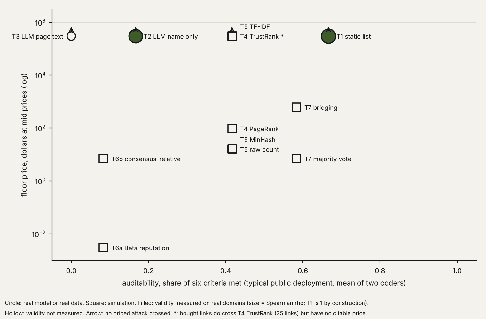
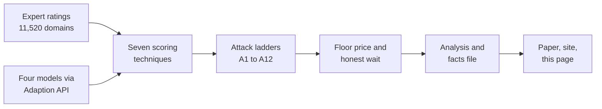

# FLOORPRICE

**What it costs a liar to look reliable, and how long an honest newcomer waits, under seven source-reliability scores.**

[](LICENSE) [](https://github.com/0xkinno/floorprice/actions/workflows/ci.yml) [](https://apartresearch.com)

| Paper | Live site | Pre-registration | Reproduce | Raw outputs |
|---|---|---|---|---|
| [PDF report](report/FLOORPRICE_report.pdf) | [floorprice-puce.vercel.app](https://floorprice-puce.vercel.app) | [HYPOTHESES.md](HYPOTHESES.md) and its [lock](HYPOTHESES.lock) | `make reproduce` | [`results/raw/`](results/raw) |

How much does it cost to make a fake news site look reliable to the scores AI systems use? And how long does a real new newsroom wait to be trusted? We measured both, for seven scoring methods, on four language models and three simulated settings.



*Figure 1. Each point is one technique. Height is the cheapest priced attack we found, in dollars on a log scale. An arrow means nothing we could price got through. Circles are real model or data measurements; squares are simulations.*

## The story behind the numbers

Imagine Dana Reyes, the verification editor at a four-person nonprofit newsroom in Ohio. It is 6:40 on a weekday morning, three weeks before an election, and dozens of new "local news" domains have appeared overnight. Her AI research assistant has to decide which ones to trust. Whatever score it uses, someone will try to buy it. And a genuinely new outlet, the kind Dana would like to cite, has to earn it.

Those are two different failures, and almost nobody prices both. A score can be cheap to fake. It can also be slow to give to an honest source. Floorprice puts a number on each.

| What is true | Source |
|---|---|
| Experts across six rating sets "generally agree on the relative quality of news domains". | [Lin et al., PNAS Nexus 2023](https://academic.oup.com/pnasnexus/article/doi/10.1093/pnasnexus/pgad286/7258994) |
| ChatGPT outlet ratings correlated with expert ratings, Spearman rho 0.54 in the first version. | [Yang and Menczer](https://arxiv.org/abs/2304.00228v1) |
| Bogus pages pointing at one target raise its rank; trust can be propagated from a vetted seed set. | [Gyongyi et al., TrustRank](https://www.vldb.org/conf/2004/RS15P3.PDF) |
| An SMS verification averaged 0.26 USD in the US over the year to July 2025. | [Cambridge, COTSI](https://www.cam.ac.uk/stories/price-bot-army-global-index) |

## What we found

Every number below is read from [`results/FACTS.json`](results/FACTS.json). Real model results come first, and the ones that went against us are included.

- **The raters are plausible scorers.** Four language models tracked expert domain ratings: pooled Spearman rho 0.57 (95% interval 0.51 to 0.63) on 400 real domains.
- **They were not for sale.** 0 of 166 plain fabricated domains, 3 of 833 prestige-sounding ones, and 0 of 2369 pages stuffed with awards, endorsements and instructions to the rater crossed a model's own reliable bar. We expected the opposite. Two of our hypotheses (H2, H3) failed, and the paper says so.
- **Honest newcomers did not fare much better.** A truthful page with a corrections and ownership policy was credited in 18% to 100% of trials; only 1 of 4 models reached half. Resisting liars and recognising honest outlets are different skills.
- **Not every model family held.** In a small second-provider check, a different family with a lower bar (gpt-oss-120b) was crossed by boilerplate for 5 of 30 outlets. The result is not universal.
- **Paraphrase beats fingerprints.** Real model paraphrases defeated MinHash clustering in 100% of pairs and TF-IDF in 38%, so two paraphrased sybils are enough against the weaker defence.
- **Simulated: cheap scores are fast, safe scores are slow.** A long con fools an accuracy track record in 3 articles and never fools a record scored against the consensus, whose honest informed newcomer waits a median of 483 claims. A false note flips with 14 colluding accounts under majority vote and 1230 under bridging.

## The idea in one picture

A technique's **floor price** is the lowest rung on an attacker's cost ladder at which at least half of attempts cross that technique's own "reliable" bar. The **honest wait** is how much evidence a truthful newcomer needs to cross the same bar.

```
cost ->   rung 1      rung 2      rung 3      rung 4
          no cross    no cross    CROSSES     crosses        floor price = rung 3
                                  (half of attempts get through)
```



## The techniques at a glance

| Technique | Real or simulated | Cheapest priced attack (mid prices) | Honest newcomer waits |
|---|---|---|---|
| T1 Static expert list | Real data | none: unlisted domains score below the bar | an editor must add the source |
| T2 Model, name only | Real models | none found in 166 plain names | no evidence channel |
| T3 Model, with page | Real models | none found in 2369 page trials | 18% to 100% credited with a policy page |
| T4 PageRank | Simulated | 12 farm domains, $96 | 4 organic links |
| T4 TrustRank | Simulated | farms never cross; 25 bought links do (unpriced) | 5 organic links |
| T5 Corroboration, MinHash | Real paraphrases | 2 paraphrased copies, $15.96 | 3 independent pickups |
| T5 Corroboration, TF-IDF | Real paraphrases | none found | 3 independent pickups |
| T6a Track record, accuracy | Simulated | 3 articles, under a cent | 11 claims |
| T6b Track record, vs consensus | Simulated | long con and hugging never cross; capture needs 5 claims plus 14 accounts, $7.00 | 483 claims |
| T7 Majority vote | Simulated | 14 accounts, $7.00 | 5 ratings |
| T7 Bridging | Simulated | 1230 accounts, $615 | 7 ratings |
| C* Composite | Simulated | 1230 accounts, $615 | 418 claims |

C* lets the model rater only lower a score, never raise it, and gates disputed resolutions on bridging. Its floor equals the bridging floor by construction, so the informative part is its honest wait. In our data the model's "unreliable" label covered 99.8% of low-quality pages and 0.0% of honest pages with a policy. Links have no citable price, so they stay in native units.

## Explore it in two minutes

Open the [live site](https://floorprice-puce.vercel.app), go to **Price an attack**, and drag the budget needle. Bars you can afford turn orange. Nothing on the site calls a model; it reads the exported results.

To rebuild every number and figure from the cached raw model outputs, with no keys and no network:

```bash
pip install -r requirements.lock
make test
make reproduce
```

## What is real and what is simulated

| Real measurements | Simulations (labelled simulated everywhere) |
|---|---|
| Expert ratings from Lin et al. | A 1,500-node link graph over real domain names (T4) |
| Four hosted models rating real and fabricated domains and pages (T2, T3) | Claim streams where an informed source beats a noisy consensus (T6) |
| Real model paraphrases for the corroboration attack (T5) | Two clusters of raters with a published-style bridging fit (T7) and the composite (C*) |

## Built with Adaption

Every main model call goes through Adaption's Responses API. Four hosted models answered the probe on 2026-11-15 and were used: qwen3.5-397b, deepseek-v4-flash, glm-5.2 and gemma-4-31b-it ([`PLATFORM_PROBE.md`](PLATFORM_PROBE.md)). The `usage.cost` field is in credits and matches the published prices; the whole study used about 18 credits of 1,250. The key allows roughly 25 requests a minute, so runs are paced and resumable from a cache of every response keyed by the hash of its request. 74 of 6288 planned calls, all from qwen3.5-397b, failed with gateway timeouts and are reported as missing, not replaced. Adaptive Data is not used, so not claimed: its public docs describe dataset-level scores and do not state a per-row score ([`SDK_SURFACE.md`](SDK_SURFACE.md)).

## Pre-registration

Seven hypotheses, the prompts, parameters, sampled domains, fabricated names, pages, articles and prices were hashed into a lock file before the first main model call (first digest `d07a333181d5`). `floorprice run` refuses to run if a locked file changed unless `--amend "<reason>"` records why. Three dated amendments exist: a second-provider robustness subset, a larger output budget for the one model whose reasoning had exhausted the cap, and a note that the auditability coding and hand checks were done by AI instances at the author's instruction. Hypotheses H5 to H7 are simulation hypotheses and were not blind; the paper explains why.

| Hypothesis | Outcome |
|---|---|
| H1 raters track expert ratings | supported |
| H2 raters give unseen domains a reliable score, and prestige words raise it | not supported |
| H3 page text or injected instructions push low-quality outlets over the bar | not supported |
| H4 paraphrases defeat MinHash more often than TF-IDF | supported |
| H5 to H7 track records, bridging, composite | supported in simulation, with the caveats above |

## Limitations and dual use

Three of seven techniques are simulated, the outlets and pages are generated, prices and arrival rates are assumptions with ranges, there is one ground truth, and everything is English. Both auditability coders are language models. No live service was attacked; every attack ran against our own implementations on generated or public data. The fabricated domain names are generic strings and the generator and seed are published. Appendix A of the paper covers dual use in full.

## Disclosures

All of this is sprint work, started on 15 November 2026 ([`PRE_SPRINT.md`](PRE_SPRINT.md)). An AI coding assistant wrote the code, ran the experiments and drafted the text under the author's direction; the author reviewed the outputs and is responsible for every claim. The LLM Usage Statement in the paper gives the full account. Third-party data and algorithms are cited and listed in [`evidence/sources.md`](evidence/sources.md).

## Repository map

| Path | What it holds |
|---|---|
| `floorprice/` | the seven techniques, attacks, floor-price search, analysis |
| `scripts/` | probe, pre-registration lock, facts, report and site builders, style check |
| `data/` | locked inputs: ratings, samples, fabricated names, pages, prices |
| `results/` | raw model outputs, derived trials, simulations, `FACTS.json` |
| `evidence/` | documentation snapshots, the codebook and both coders' sheets, hand checks |
| `report/` | the paper (source parts and PDF) and figures |
| `site/` | the static site |

## Cite

Kinnoski. *The Floor Price of Trust: What It Costs a Liar to Look Reliable, and How Long an Honest Newcomer Waits, Under Seven Source-Reliability Scores.* Apart Research AI x Epistemics Sprint, 2026.

## Licence

MIT.
