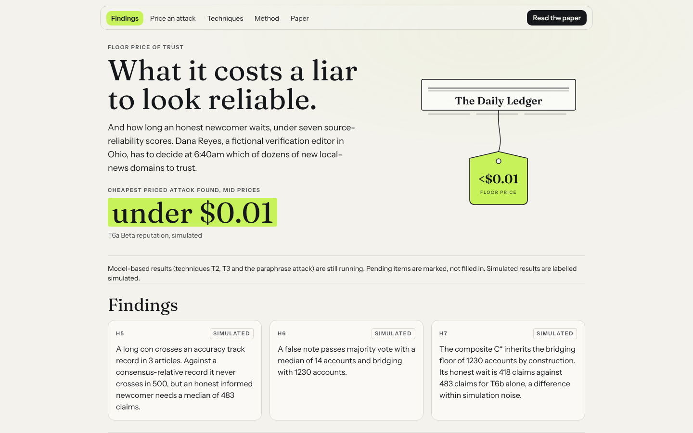
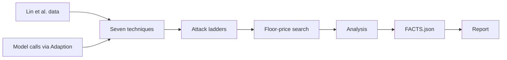

# FLOORPRICE

**What it costs a liar to look reliable, and how long an honest newcomer waits, under seven source-reliability scores.**

Apart Research AI x Epistemics Sprint, Track 2 (Trust Infrastructure), also Track 1. MIT licence. Author: Kinnoski (0xkinno).

| Paper | Site | Reproduce | Pre-registration | Raw outputs | Track |
|---|---|---|---|---|---|
| [PENDING PDF] | [floorprice-puce.vercel.app](https://floorprice-puce.vercel.app) | `make reproduce` | [HYPOTHESES.md](HYPOTHESES.md), [lock](HYPOTHESES.lock) | `results/raw/` | Track 2 |

How much does it cost to make a fake news site look reliable to the scores AI systems use? And how long does a real new newsroom wait to be trusted? We measure both, for seven scoring methods. Model-based results are [PENDING: the real-model runs need an API key that was not available when this was written]. Simulated results are labelled simulated.

[PENDING Figure 1]

## The problem

Dana Reyes is a fictional verification editor at a four-person nonprofit newsroom in Ohio. At 6:40am, three weeks before an election, dozens of new "local news" domains appear overnight and her AI research assistant has to decide which to trust.

| What is true | Source |
|---|---|
| Experts across six rating sets "generally agree on the relative quality of news domains". | [Lin et al. 2023](https://academic.oup.com/pnasnexus/article/doi/10.1093/pnasnexus/pgad286/7258994) |
| ChatGPT outlet ratings correlated with expert ratings, Spearman rho 0.54 (first version). | [Yang and Menczer](https://arxiv.org/abs/2304.00228v1) |
| SMS verification averaged 0.26 USD in the US over the year to July 2025. | [Cambridge press release](https://www.cam.ac.uk/stories/price-bot-army-global-index) |

## What we did

1. Took 11,520 domains with expert ratings as ground truth and defined "reliable" as `pc1 >= 0.7`.
2. Implemented seven ways to score reliability. Each gives a score, its own threshold and a receipt anyone can recompute.
3. For each, searched for the cheapest attack that crosses the threshold, priced it in native units and dollars (low, mid, high).
4. Measured how long an honest newcomer waits under the same threshold.
5. Tested a composite rule in which the language-model rater can only lower a score.

## What we found

Findings are filled from `results/FACTS.json` only. Simulated findings available now:

- A long con crosses an accuracy track record in {{fact:hypotheses.H5.con_T6a_median_articles}} articles (simulated) and never crosses a consensus-relative record in 500, whose honest informed newcomer needs a median of {{fact:hypotheses.H5.honest_T6b_median_claims}} claims (simulated).
- False-note brigading needs a median of {{fact:hypotheses.H6.majority_median_accounts}} accounts under majority vote and {{fact:hypotheses.H6.bridging_median_accounts}} under bridging (simulated).
- [PENDING findings from real model runs, including at least one hypothesis that failed if one did.]

## Explore it in 2 minutes

[PENDING site]. To reproduce every number from cached raw outputs, with no keys:

```bash
make reproduce
```

## How it works



```
cost ->  rung 1     rung 2     rung 3     rung 4
         no cross   no cross   CROSSES    crosses      floor price = rung 3 (half of attempts cross)
```

## Built with Adaption

Models run through Adaption's Responses API. [PENDING: model IDs, dates, credits used per experiment and probe results.] Adaptive Data is not used, so not claimed: its public docs describe dataset-level scores, and a per-row score is not stated (see `SDK_SURFACE.md`).

## What is real and what is simulated

| Technique | Real or simulated |
|---|---|
| T1 static list | Real data |
| T2 LLM rater, name only | Real model calls |
| T3 LLM rater, with page | Real model calls on generated pages |
| T4 link graph | Simulated graph over real domain names |
| T5 corroboration | Simulated sources, paraphrases from real model calls |
| T6 track record | Simulated claim streams |
| T7 bridging | Simulated raters |

## Pre-registration

Hypotheses H1 to H7 were hashed into `HYPOTHESES.lock` before any main model call. `floorprice run` refuses to run if a locked file changed unless `--amend "<reason>"` is given.

## Reproduce

```bash
pip install -r requirements.lock
make test
make reproduce
```

## Limitations and dual use

Simulated graph, claim streams and raters; fictional outlets with templated pages; prices are assumptions with ranges; one ground truth; English only. No live service was attacked. See Appendix A of the paper.

## Disclosures

All work is sprint work, started on 15 November 2026 (`PRE_SPRINT.md`). AI assistants helped write code and drafts under Kinnoski's direction. Third-party data and algorithms are cited.

## Repository map

`floorprice/` code, `scripts/` tooling, `data/` locked inputs, `evidence/` snapshots and codebook, `results/` raw outputs and simulations, `report/` paper, `tests/`.

## Cite

Kinnoski. The Floor Price of Trust. Apart Research AI x Epistemics Sprint, 2026.

## Licence

MIT.
